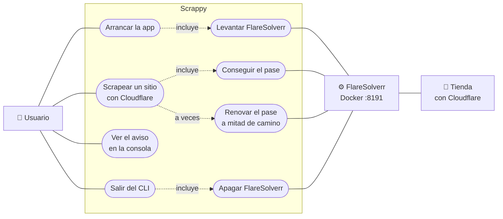
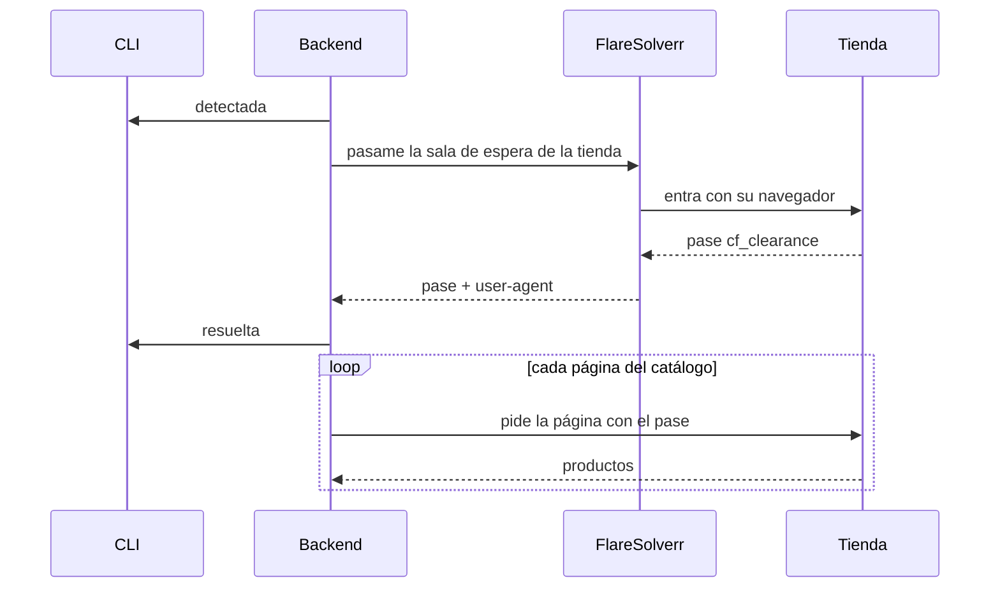
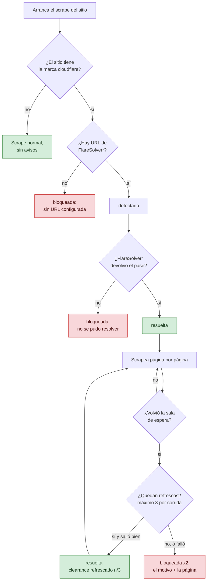
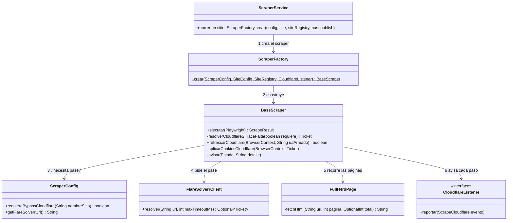
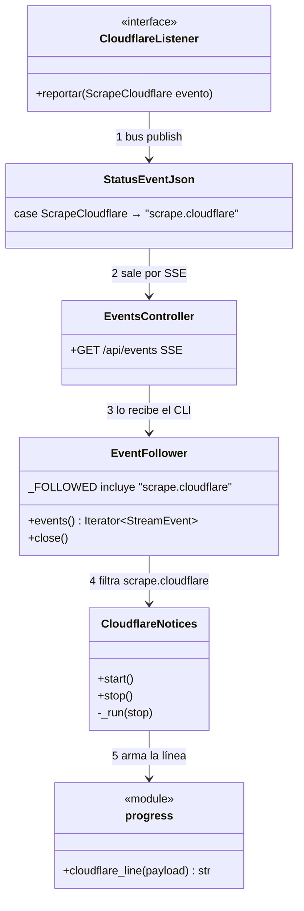

# Sitios configurados

> Tabla de sitios, plataformas, rubros y detección de plataforma. Movido desde `CLAUDE.md` (2026-09-28), que pasó a ser sólo índice.

## Sitios configurados (`config.properties`)

**Marca propia (`sitio.monomarca`, V52).** En una tienda de marca propia la
marca *es* la tienda: `NormalizerService` le pone `marca = sitio.nombre` tal
cual (`Monkyforce`, `Mmartinez`), por encima de cualquier match de
`BrandExtractor`. Sin eso la marca queda NULL (V19 abstiene) y la tienda no
aparece en `/marcas` ni en la búsqueda. Un sitio nuevo de marca propia necesita
el flag **y** su nombre en la tabla `marca` (FK; si falta, el upsert dice
`"0 nuevos"`). Hoy: freres, fuark, mmartinez, monkyforce, harvey, bulks,
bullbenny, batuk, tussy, foreverbstrd, forever, fursten, barnes, vcp, eldon,
midway, inpro, flowin, vayzenhome, mrplacadeco, ambiancedeco, baesics. Zentra **no**:
revende el catálogo de INPRO.

| Sitio | Plataforma | Rubro | Notas |
|-------|-----------|-------|-------|
| freres, vcp, forever | Shopify | moda | `forever` está en el name-set SHOPIFY desde 2026-07-14 (antes caía a TN y daba 0 productos) |
| foreverbstrd | Tiendanube | moda | `/collections/all` (URL estilo Shopify) pasó a dar 404; catálogo real en `/productos/`. Es TN real — **NO** agregarlo al name-set |
| harvey | Tiendanube | moda | Única con `urls_extra` (outlet `otras-temporadas1`, pagina con `?page=N`; `?mpage=N` no pagina — el server ignora el parámetro y sirve siempre la misma página) |
| midway, batuk, tussy, bulks, bullbenny, barnes, eldon | Tiendanube | moda | Batuk+Huoky misma tienda (huoky comentado) |
| fuark, fursten | Tiendanube | gym | Fursten pagina solo vía fallback `?page=N`. `gymrat` sale de `SiteClassification.GYM_SITIOS` (Java), no de una columna de `sitio` |
| baesics | Shopify | gym | Marca propia. **56 productos**, todos en la página 1 de `/products.json` (medido 2026-10-27). Sólo fila de seed (`V54`) + `GYM_SITIOS`. curl pelado recibe `429 local_rate_limited`; Playwright no |
| monkyforce | Monkyforce (propio) | gym | |
| entreno | Tiendanube | suplementos | **~636 productos**: 53 páginas de 12, la 54 devuelve 0 (medido 2026-08-20). Hasta el tope configurable rendía ~313 — el techo de 25 páginas cortaba a la mitad, en silencio. El scroll infinito corre **sólo** en `/productos/` pelado y se **apaga** con `?page=N` en la URL, así que lo que pagina de verdad es `?page=N`; `?mpage=N` es marcador client-side y no pagina nada en el HTML crudo. No tiene links de pager en el DOM: llega a la página 2 por el fallback que construye la URL |
| morashop | Morashop (Tiendanube, page propia) | suplementos | Competidor directo de entreno, ~510 productos crudos en 12 categorías hoja. **NO es plataforma `tiendanube`** aunque la tienda lo sea: el extractor compartido le sirve tal cual, pero necesita page propia porque **no tiene URL de catálogo**. `/productos/` es una landing del tema con CERO productos y `/suplementos/` es un índice, también cero — apuntar a cualquiera de las dos da 0 en silencio (la clase de bug que cerró `V24`). `MorashopPage` descubre las hojas del landing en runtime y **tira `MorashopDiscoveryException`** si no encuentra ninguna. La API REST de TN da 404 acá, pero además está **apagada a propósito** (`usaApi()=false`): devuelve la tienda entera sin filtro por sección, y morashop además vende supermercado, electro-hogar y bodega, rubros que no tienen valor en el dominio. Sólo se crawlea `/suplementos/` |
| sporting | VTEX | deportes | ~7150 productos (2026-09-28); la API Legacy corta en ~2550 por consulta, se parte por categoría (ver `ADD_SCRAPER.md` → Caso 3) |
| vaypol, city | Vaypol (Rails SSR custom) | deportes | |
| dcshoes | WooCommerce | moda | |
| fullh4rd | Scraper propio (`FullH4rdPage`) | tecnologia | Hardware/PC. Rediseño del sitio (2026-09-28): `/productos?page=N` lista el catálogo ENTERO como `article.results-card` — **1918 productos**, 12/página, p160 trae 10, p161 trae 0. `price-current` es el precio, `price-list` el de lista (precioOriginal sólo si es mayor). `meta` es la categoría. `curl` da 403 acá y **desde 2026-10-08 el dominio entero responde 403 con challenge de Cloudflare** (`cf-mitigated: challenge`; marcadores `challenge-platform`, `__cf_chl`, `<title>Just a moment...</title>`), así que Playwright pelado tampoco entra: el sitio está marcado `sitio.fullh4rd.cloudflare=true` y `BaseScraper` resuelve **un** clearance por run vía FlareSolverr (`scraper.flaresolverr.url`, o `SCRAPER_FLARESOLVERR_URL` en Docker; en la instalación POSIX lo levanta `Ejecutar_instalar.sh` como el contenedor `fashion-scraper-flaresolverr` y salir del CLI lo apaga, salvo uno que ya respondía en 8191 antes del instalador) y replica la cookie `cf_clearance` + el UA que la ganó en su propio contexto de Playwright — mismo NAT saliente, la atadura por IP se mantiene. Medido 2026-10-12: **1869 de 1890** productos en un run real con el bypass. Sin solver (o con el challenge sin resolver) el run corta con `CloudflareBlockedException` y un mensaje explícito, nunca con un "0 productos" silencioso. Flujo completo en [Sitios detrás de Cloudflare](#sitios-detrás-de-cloudflare). Sirve el `src` del listado **root-relative** (`/img/productos/{cat}/{slug}-0.jpg`) — se absolutiza con `ImageUrl` como cualquier otro. Reemplaza el viejo árbol `/cat/supra/{id}/{name}/{page}` con `FH_CATS` hardcodeado (perdía CPUs, motherboards, fuentes) que ya no matcheaba el markup en vivo |
| maximus | Scraper propio (API session-gated) | tecnologia | URL: `/Productos/{Slug}/maximus.aspx?/CAT={id}/SCAT=-1/M=-1/OR=1/PAGE={p}/` (el `{Slug}` es cosmético, sólo `CAT=` rutea — confirmado en vivo). Productos vía `POST /wfmWebSite2.aspx/wsNRW_Script` **desde adentro de la página ya navegada** — un cookie-less call responde HTTP 200 con `{"d":"-2, Módulo GlobalBluePoint© GBPScripts NO ADQUIRIDO."}` (el gate no se detecta por status code). `parseMaximusPayload` **lanza** `MaximusPayloadException` ante esa forma en vez de devolver una categoría vacía silenciosa — se propaga sin atrapar hasta `BaseScraper.ejecutar`. La API no trae un campo de imagen, pero sí `item_code4web`: la imagen es `{base}/Temp/App_WebSite/App_PictureFiles/Items/{item_code4web}_600.jpg` (HEAD 200 en 121/121, CAT 48/56/68/3/10, 2026-08-15). Sin código → abstención. **745 productos** en un run real de sitio completo (2026-08-13): 73 categorías descubiertas del nav, 1122 únicos, 745 dentro de `precio.maximo` |
| compragamer | Scraper propio (feed JSON) | tecnologia | Lee `static.compragamer.com/productos` directo (1389 items, sin auth, sin paginar) — no scrapea el DOM de la SPA Angular. **650 productos** en un run real tras filtrar por stock/vendible y bandas de precio (2026-08-13). Dos claves del feed hay que reconstruirlas, no usarlas crudas: la imagen es `imagenes.compragamer.com/productos/compragamer_Imganen_general_{imagenes[].nombre}.jpg` (el typo `Imganen` es de ellos; sin el prefijo, el bucket S3 da `403 AccessDenied`), y la URL de producto es `/producto/{slug}_{id}` — el router de la SPA rutea por el sufijo `_{id}` y manda `/producto/{id}` pelado al home |
| rockethard | Qloud (propio, multi-tienda) | tecnologia | Server-rendered, `?page=N`. **503 productos** en un run real de sitio completo con las bandas de precio de producción (2026-08-13) tras registrarlo — nunca había tenido fila en `sitio` ni entrada en `config.properties`. `/productos` es 404 confirmado, nunca usar esa ruta |
| venex | osCommerce (propio) | tecnologia | Descubrimiento en dos niveles: categoría top → sub-categorías leaf en su landing (la landing muestra 12 productos no representativos, nunca se cuentan). `?page=N`, se detiene en página vacía **o** repetida — pasado el final real, Venex repite la última página en vez de devolver vacío. `page.content()` sirve el DOM re-serializado por Chromium (comillas dobles + entidad `&quot;`), no el HTML crudo del servidor (comillas simples) — el parser normaliza antes de matchear. El argumento de `enhancedClick` se lee **con Jackson**, no campo por campo con regex: los nombres traen la pulgada escapada (`15.6\"`) y un `"name":"([^"]*)"` se corta ahí y tira la card entera en silencio — medido en `/notebooks/`, eso costaba 20 de 47 productos únicos (2026-08-15). **1294 productos** en un run real de sitio completo (las 19 categorías top, 2026-08-13), sub-contado por esa pérdida. Una card con `label-no-stock` **y** precio 999999 se descarta: es el placeholder de Venex para algunos sin stock (bajas falsas de -99% en el historial, 2026-08); con stock, 999999 es un precio real (combos) y se guarda |
| inpro | Inpro (Tiendanube headless) | oficina | Sillas ergonómicas, standing desks, brazos de monitor, iluminación. **NO es plataforma `tiendanube`**: sirve los objetos crudos de la API de Tiendanube pero la vidriera es un Next.js propio en Vercel, y el storefront clásico no es alcanzable (`inpro.mitiendanube.com` redirige a *otra* tienda, `inproindumentaria.com.ar`; los slugs candidatos dan 410). El catálogo se lee del payload RSC (`self.__next_f`), no del DOM. Enumera por `/server-sitemap.xml` (106 productos, 16 categorías) → páginas de categoría (100 productos en 16 fetches) → los 6 handles que ninguna categoría mostró, de a uno. **101 productos** en una corrida real (2026-08-20); los 5 `pod-*` restantes son cabinas con `price: null`, se venden a consultar. El orden de las claves del JSON **no** es estable: en categoría el objeto abre con `id`, en producto con `name` — anclar en `{"id":` da 0 en la mitad de las superficies, en silencio |
| zentra | Tiendanube | oficina | Sillas ergonómicas y standing desks — mismo catálogo que INPRO, pero Tiendanube **clásico**, no headless: `[data-product-id]` en el DOM y el extractor compartido lo lee sin tocar nada. **44 productos, todos en UNA página** (medido 2026-08-26): `?page=2` sirve una página vacía, así que corta el chequeo de dos vacías seguidas. La imagen viene SÓLO en `data-srcset` — el `src` es un GIF base64 de lazy-load en 44/44 cards; el extractor ya prueba `data-srcset` primero y descarta base64/placeholder |
| mmartinez | Tiendanube | moda | Calzado. **37 productos de a 12 por página** (medido 2026-08-26); pagina con `?page=N` y `?mpage=N` devuelve la página 1 (marcador client-side, igual que entreno). Sus cards traen **seis** elementos de precio: el real, dos de descuento por transferencia, uno de cuota, un contenedor con todo concatenado y un `js-compare-price-display` **oculto que dice `$0`**. El extractor toma la primera HOJA que parsea a > 0, así que saltea el `$0` y agarra bien (12/12); ese `$0` además llega a `compare`, pero `PrecioParser` excluye el cero y devuelve `empty`, así que `precioOriginal` queda NULL y no fabrica un descuento contra cero |
| flowin | Shopify | oficina | Escritorios regulables y sillas ergonómicas. **8 productos**, todos en la página 1 de `/products.json` (medido 2026-10-08, 8/8 con foto). Sólo fila de seed (`V43`), sin código. Los dos combos escritorio + silla se clasifican `Silla` |
| armytech | PrestaShop (`PrestashopPage`) | tecnologia | Hardware/PC. `/2-productos` es la categoría raíz: pedida con `Accept: application/json` + `X-Requested-With: XMLHttpRequest` devuelve el JSON de listado de PrestaShop 1.7 (`products[]` + `pagination.pages_count`, 48 por página). **546 productos** en una corrida real (2026-10-08): 549 `total_items` menos 3 filas "Marca - X" con precio 0, que se descartan explícitamente porque `precio.minimo` es 0. 529/546 con foto: el resto trae `cover: false`, no `null`. Listado vacío → `PrestashopPayloadException` |
| gamerfactory | `GamerFactoryPage` | tecnologia | Hardware/PC y periféricos (SPA React propia, sin plataforma conocida detrás). El catálogo sale de la API pública `core.gamerfactory.com.ar/products/search`: **una sola petición** con `perPage=1000` devuelve los 828 productos (`{total, data[]}`); la page pagina sólo si llegan menos que `total` y **lanza** si al final faltan. `precio` = `price.special.ARS` (el precio de transferencia, ~12 % bajo `price.list.ARS`, que es el de tarjeta en 1 pago); `precioOriginal` sólo si `special.strikethrough > special.ARS` (171 de 828 en la captura 2026-10-10) — lista vs. especial es un medio de pago, no un descuento. URL `/producto/<slug>`, foto `images[0].url`, marca de `brand`. No filtra por `type`: clasifica `CategoryClassifier`. Payload vacío o malformado → `GamerFactoryPayloadException`, nunca 0 en silencio |
| mrplacadeco, vayzenhome | Tiendanube | construccion | Revestimientos autoadhesivos (placas, vinilos, pisos, plantas artificiales). ~23 y ~42 productos (2026-10-13). Sólo fila de seed (`V45`) |
| ambiancedeco | Tiendanube (page propia, `AmbiancedecoPage`) | hogar | Se scrapea entero: ~108 productos, ~90 textiles de hogar y ~17 revestimientos. El rubro forzado es `hogar`, pero `RubroResolver` manda cada revestimiento a `construccion` por su categoría (`V45`). La page propia existe porque en `?page=2` el primer `a[href*='page=']` es el link de la página actual y el genérico navegaba a p3 como p2 (perdía 8 productos); sobreescribe `nextPageUrl` (`V46`) |
| vans | — | — | Comentado: plataforma Grimoldi custom, sin scraper |

### Detección de plataforma (`ScraperFactory.crear`, en orden)

Desde `V20` esto lee `sitio.plataforma` vía `SiteRegistry`, no name-sets en
código (ver [`docs/ADD_SCRAPER.md`](./ADD_SCRAPER.md)). La lista de abajo
es qué sitio hoy tiene sembrado cada valor, no un `Set.of(...)` a editar:

```
WOOCOMMERCE → dcshoes
MAXIMUS → maximus   FULLH4RD → fullh4rd   COMPRAGAMER → compragamer
VAYPOL  → vaypol, city
QLOUD   → rockethard
OSCOMMERCE → venex
INPRO   → inpro
VTEX    → sporting, o url contiene vtexcommercestable.com.br / vteximg.com.br
SHOPIFY → freres, vcp, forever, flowin, baesics, o url contiene myshopify.com
MONKYFORCE → monkyforce
MORASHOP → morashop
PRESTASHOP → armytech
GAMERFACTORY → gamerfactory
AMBIANCEDECO → ambiancedeco
default → TiendanubePage (JS heurístico)
```

`plataformaDeFavorito`/`crearParaFavorito` resuelven favoritos solo a SHOPIFY/VTEX.

---


## Sitios detrás de Cloudflare

### La idea en 30 segundos

Algunas tiendas (hoy sólo **fullh4rd**) ponen delante a **Cloudflare**: antes
de mostrar la página aparece una "sala de espera" (`Just a moment...`) que
comprueba que sos un navegador de verdad. Nuestro scraper no la pasa solo.

**FlareSolverr** es un navegador aparte, en un contenedor Docker, que sí la
pasa. Cuando la pasa, Cloudflare le da un **pase**: la cookie `cf_clearance`.
El pase sólo vale para el mismo navegador (el *user-agent*) y la misma
conexión (la IP). Por eso el scraper copia las dos cosas, la cookie y el
user-agent, y entra a la tienda como si fuera ese navegador.

En cada paso el backend avisa, y la consola del CLI lo muestra solo:

```text
[Cloudflare] Fullh4rd: detectada — resolviendo via FlareSolverr
[Cloudflare] Fullh4rd: resuelta — clearance obtenido
```

### Las piezas



| Pieza | Qué hace | Cuándo vive |
|---|---|---|
| `Ejecutar_instalar.sh` | Levanta el contenedor `fashion-scraper-flaresolverr` y deja la marca `_tools/flaresolverr.owned` ("este lo levanté yo") | Al instalar o arrancar la app |
| FlareSolverr | Pasa la sala de espera y devuelve el pase | Mientras la app está abierta |
| Backend | Pide **un** pase por corrida, lo usa y avisa cada paso | Mientras la app está abierta |
| CLI | Escucha los avisos y los imprime. Al salir apaga FlareSolverr, pero sólo si existe la marca | Mientras la app está abierta |

Si ya tenías otro FlareSolverr en el puerto 8191, el instalador lo usa y no
deja marca, así que al salir el CLI no lo toca.

### Una corrida, paso a paso



El pase se pide **antes** de abrir el navegador del scraper. Así el navegador
nace con el user-agent correcto, que después no se puede cambiar.

### Qué puede salir mal



Cualquier `bloqueada` termina igual: ese sitio queda con 0 productos y en
`ERROR` en esa corrida. Los productos que ya estaban en la base no se tocan.
Se verificó el 2026-10-14 con FlareSolverr apagado: fullh4rd siguió con sus
1862 productos activos.

### Qué ves en la consola

| Línea | Qué significa | Qué hacer |
|---|---|---|
| `detectada — resolviendo via FlareSolverr` | El sitio necesita pase y se le pidió a FlareSolverr | Nada |
| `resuelta — clearance obtenido` | Hay pase: el scrape sigue normal | Nada |
| `resuelta — clearance refrescado (n/3)` | El pase venció a mitad de camino y se pidió otro | Nada, salvo que llegue a 3/3 seguido |
| `bloqueada — FlareSolverr no disponible: sin URL configurada` | Falta `scraper.flaresolverr.url` | Configurarla (en Docker: `SCRAPER_FLARESOLVERR_URL`) |
| `bloqueada — no se pudo resolver el challenge` | FlareSolverr está apagado, falló o no consiguió el pase | Ver "Dónde mirar" |
| `bloqueada — no se pudo refrescar el clearance` | Falló el pase nuevo a mitad de camino | Ídem |
| `bloqueada — el UA del clearance nuevo no coincide` | El pase nuevo vino para otro user-agent, y el navegador ya abierto no lo puede cambiar | Reintentar la corrida |
| `bloqueada — tope de 3 refrescos alcanzado` | La sala de espera vuelve una y otra vez | Probar más tarde |
| `bloqueada — [Fullh4rd] pN: challenge de Cloudflare sin resolver…` | La página N mostró la sala de espera y no se pudo seguir | Suele llegar junto con el motivo, una línea antes. Si el corte fue en el último reintento de la página, llega sola |

Cuando el corte pasa a mitad de camino salen **dos** líneas `bloqueada`: una
con el motivo y otra con la página donde se cortó. El formato exacto del aviso
está en [`API_REFERENCE.md`](./API_REFERENCE.md) (`scrape.cloudflare`).

### Dónde mirar cuando falla

1. **¿FlareSolverr está vivo?** `curl http://localhost:8191/` tiene que
   responder `FlareSolverr is ready!`. Si no responde, volvé a correr
   `./Ejecutar_instalar.sh` o mirá `docker logs fashion-scraper-flaresolverr`.
2. **El log del backend**, en `scraper/logs/`: buscá
   `resolviendo challenge de Cloudflare`, `FlareSolverr no disponible`,
   `FlareSolverr HTTP` o `respondió sin cf_clearance`.
3. **Sin Docker** el instalador avisa y sigue. En ese caso sólo fallan los
   sitios con Cloudflare, y hay que levantar FlareSolverr a mano en el 8191.

### Para el que va a tocar código

El backend, de arriba hacia abajo: quién crea a quién y a quién le pide el pase.



`FullH4rdPage` no conoce a `BaseScraper`: recibe un `CloudflareSolver` (que es
`BaseScraper::refrescar`) y lo llama cuando `BasePage.esBloqueoCloudflare(html)`
ve la sala de espera.

El aviso, del backend a la consola:



| Archivo | Rol |
|---|---|
| `scraper/.../scrapers/BaseScraper.java` | Pide el pase antes de abrir Chromium, lo aplica (cookies + user-agent), refresca a mitad de camino y emite los avisos |
| `scraper/.../scrapers/FlareSolverrClient.java` | Habla con FlareSolverr (`POST /v1`, `request.get`); sin `cf_clearance` en la respuesta no hay pase |
| `scraper/.../pages/FullH4rdPage.java` | Detecta la sala de espera (`BasePage.esBloqueoCloudflare`), pide refresco y reintenta la misma página; si no puede, lanza `CloudflareBlockedException` |
| `scraper/.../scrape/CloudflareListener.java`, `StatusEvent.ScrapeCloudflare` | El aviso: `sitio`, `estado` (`DETECTADA` / `RESUELTA` / `BLOQUEADA`) y `detalle` |
| `scraper/.../web/ScraperService.java` | Le pasa `bus::publish` a cada scraper; `StatusEventJson` lo publica como `scrape.cloudflare` |
| `cli/core/notices.py` | `CloudflareNotices`: hilo que escucha desde `start` hasta `stop`/salir y escribe la línea (`progress.cloudflare_line`) |
| `cli/core/flaresolverr.py` | `FlareSolverrService`: al salir hace `docker stop`, pero sólo si existe la marca |
| `Ejecutar_instalar.sh` | Paso `[CF]`: levanta el contenedor y deja la marca |

### Agregar otro sitio detrás de Cloudflare

1. Agregá el sitio como siempre ([`ADD_SCRAPER.md`](./ADD_SCRAPER.md)).
2. Sumá `sitio.<nombre>.cloudflare=true` en `config.properties`. Con eso ya
   pide el pase, lo usa y avisa.
3. **El refresco a mitad de camino no viene gratis.** La página del sitio
   tiene que detectar la sala de espera y pedir el refresco, como hace
   `FullH4rdPage.fetchHtml`. Sin eso, una sala de espera a mitad del crawl
   se confunde con una página vacía, o sea con el fin del catálogo, y el
   sitio termina antes de tiempo sin ningún aviso.
